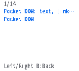
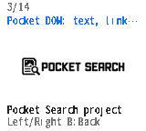
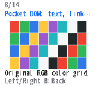
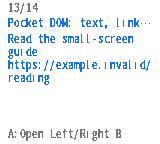
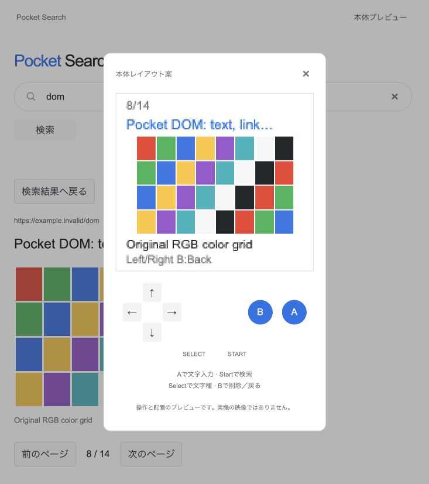

# Experimental DOM and image reader

Pocket Search now extracts an HTML5 DOM into small reading scenes: headings, paragraphs, lists, preformatted text, quotations, images and links. The companion parses HTML and prepares PNG/JPEG images; the Chromatic receives only bounded scene/pixel data. It does not hold the DOM or decode PNG/JPEG on the MCU. There is no JavaScript execution, source CSS layout, live crawler, arbitrary URL proxy or Chrome engine.

## Run and register content

```sh
cargo run --locked -- serve examples/documents.json 127.0.0.1:8828 \
  --html examples/html-manifest.json
```

Search `dom`, open **Pocket DOM: text, links and images**, then move through its 14 reading scenes. The two HTML articles, project logo and color grid are original project fixtures with nonexistent `.invalid` URLs. They demonstrate real parsing and image preparation, not live web collection. Without `--html`, existing JSON text search still works.

The manifest declares a corpus root relative to the manifest and registers each HTTPS source URL, local HTML filename and referenced image-to-file mapping. Paths must be relative without parent traversal; canonical files must remain inside the declared root. Files are loaded only at startup. Document IDs remain stable for that immutable process corpus. The API never accepts a client-provided file path or destination URL.

Active elements and selected hidden markers (`hidden`, `aria-hidden="true"`, simple inline `display:none`) are ignored. Class rules, external stylesheets and computed CSS visibility are not evaluated. HTML entities and inline spacing are preserved; headings, paragraphs, lists, `pre`, quotations and image captions become ordered scenes. Links preserve their label and complete resolved URL; A opens a target only when that URL is registered in the same collection. Other links are shown as uncollected sources. Navigation keeps at most four temporary back entries, cleared when starting a new search or leaving the reader. No bookmarks, persisted history or restored reading position are added.

Each text scene uses the existing seven-row profile. An image has one caption row; longer alt text continues on following caption pages. Unsupported images produce visible alt-text placeholders. Unsupported scripts, CSS, video and dynamic-site behavior are not emulated.

## Host limits

| Input or preparation | Limit |
| --- | --- |
| HTML manifest | 64 KiB, at most 16 added documents; total collection <=256 documents |
| One HTML source | 64 KiB UTF-8; <=8,192 DOM nodes, traversal depth <=64, <=256 extracted blocks |
| Extracted body | 64 KiB per document |
| Images / links | <=8 image references and <=32 links per HTML document |
| Image source | PNG or JPEG only; <=2 MiB, each dimension <=4,096 and <=4,194,304 pixels |
| Decoder allocation allowance | 32 MiB during host decoding; this is not a whole-process memory cap |
| Prepared image | <=128 × 80, aspect ratio retained without upscaling; alpha composited onto white; RGB565 little-endian |
| Prepared image collection | <=8 MiB of retained pixel/preview data |

Preparation occurs on the host at startup. These byte/node/dimension limits are not a parser or codec execution-time sandbox. Network fetching and its DNS/redirect/robots safeguards remain separate pending work.

## Read-only routes

| Route | Response |
| --- | --- |
| `/v1/chromatic/page?id=7&page=2` | <=512-byte PCS1 scene descriptor |
| `/v1/dom?id=7&page=2` | <=8 KiB metadata: semantic style, title/source excerpt, page count, registered link target, image dimensions |
| `/v1/chromatic/image?id=7&page=2` | PCI1 RGB565 stripe stream for that exact registered image scene; <=20,720 bytes |
| `/v1/image?id=7&page=2` | Prepared PNG of the same RGB565-quantized pixels |

Non-image scenes and unknown IDs/pages have no image response. All routes reject unknown/duplicate parameters and retain the existing GET-only, no-store, bounded-worker service. Browser text uses safe element creation and `textContent`; it never inserts source HTML. Its image canvas decodes the same PCI1 stream as the device.

## PCI1 image stripes

Multibyte fields are little-endian. One HTTP body concatenates complete stripes in top-to-bottom order, each at most 2,072 bytes. The last stripe has fewer than eight rows when needed.

| Offset | Bytes | Field |
| --- | --- | --- |
| 0 | 4 | ASCII `PCI1` |
| 4 | 1 | Version 1 |
| 5 | 1 | Format 1: RGB565 little-endian |
| 6 | 1 | Width, 1–128 |
| 7 | 1 | Rows, `min(8, height - y)` |
| 8 | 4 | Nonzero document ID |
| 12 | 2 | Reading-scene page index |
| 14 | 2 | Starting row `y`, multiple of 8 |
| 16 | 2 | Total height, 1–80 |
| 18 | 2 | Pixel payload bytes, exactly `width × rows × 2` |
| 20 | 4 | IEEE CRC-32 of pixel bytes |
| 24 | variable | Pixels, row-major |

Rust validates each header, length, dimensions and CRC without allocating; its 16-entry CRC table takes 64 read-only bytes. The transport and UI additionally require the requested document/page, consistent dimensions, exact row order and complete receipt with no trailing body bytes. CRC detects data errors; certificate-validated TLS is still required.

The native worker and GUI each retain a bounded stripe reply. The worker waits for GUI consumption before publishing another stripe. A missed consumption deadline preserves the pending buffer and marks it failed rather than overwriting unread pixels. The GUI allocates one image cache only after a valid first stripe and displays it only after complete validated receipt. That temporary cache is at most **20,480 bytes**, in addition to the **15,360-byte LVGL draw band**, network/TLS/task buffers and the retained <=512-byte scene. It is released on page change, cancellation, error or menu transition.

The native worker uses a 10 KiB task stack and cooperative cancellation checks between stages/reads. Native clock state is polled in 200 ms slices up to the 20-second synchronization limit; blocking socket calls retain their existing timeouts. A new request may wait for the old worker's safe cleanup. This is not asynchronous TLS-task destruction or a guarantee of an immediate cancellation deadline.

## Physical verification — 2026-10-10

The application-only image **0.13.12-dom**, **1,873,728 bytes**, SHA-256 `258021021ff1d02dc87a0b6f4aa5a0c984e4758baab9733f098b75fe5743cc86`, was installed with verified previous image, intended unit, recovery backup, unchanged partition table/NVS and application readback. Bootloader, FPGA and eFuses were unchanged. The Rust archive rebuilt from the recorded sources is byte-identical to the installed build input; complete upstream/font/build integration remains operator-local.

[Sanitized verification](evidence/dom-images/verification.json) records 30 successful native Wi-Fi HTTPS requests, all 14 DOM scenes, two source images, a registered link to the second article, B returning to the exact source scene, and repeated navigation. The two captured image regions matched **every prepared RGB565 pixel**. USB supplied configuration, synthetic controls and buffer readbacks; content and native clock synchronization used device Wi-Fi.

Two full-size color-grid transfers each carried 20,720 bytes, taking **2,829 ms** and **2,837 ms** through the temporary HTTPS path. The lowest sampled 8-bit free heap was **46,044 bytes** and the corresponding sampled minimum largest free block was **40,960 bytes**. Image-worker stack watermark was **2,948 bytes** in this ESP-IDF Xtensa build. These are short-run transport/heap samples at headers, stripes and cleanup, not allocator peak tracing, decoder-cycle benchmarks, render latency or a leak-free endurance claim.

The operator separately confirmed the physical LCD color image and real Left/Right page navigation. Automated controls were synthetic. Captures below are **physical MCU render-buffer readbacks over USB**, not USB video or panel scanout:

| Heading | Reduced logo | Color grid | Registered link |
| --- | --- | --- | --- |
|  |  |  |  |



Host tests cover parsing/order/entities/hidden content, unsafe links, file/path bounds, codec limits, API registration, packet/stripe truncation, CRC, dimensions and order. Hosted CI checks these independently. Full malformed-transfer/cancellation/reconnection physical acceptance, GUI stack tracing, long-duration memory tests, complete Japanese font coverage, battery-only operation and the dedicated physical-buttons/USB-video release lab remain pending. `CHROMATIC_E2E_READY` remains false. This evidence does not qualify a stable firmware release.

## Final clock-cancellation revision

Application **0.13.13-dom**, **1,873,792 bytes**, SHA-256 `1dae32aca1cb4a3aab7f0916941bcd669f82a4300f2d3179704dc55dbab07f0d`, was installed with the same application-only/readback/settings-preservation procedure. [Its separate evidence](evidence/dom-images/v0.13.13/verification.json) repeats 30 successful native Wi-Fi HTTPS requests, all 14 scenes, both full image-region comparisons and registered link/back navigation against source commit `f716bdd6fb834c51dbc52d5d4ba3e071c6a404f0`. The earlier record and operator confirmation remain unchanged.

The final worker checks cancellation between 200 ms polls of native SNTP state, without restarting synchronization. Blocking socket calls keep their timeouts; unsynchronized-clock cancellation timing and the full interruption/error release acceptance are not measured by this positive-flow run. Lowest sampled free heap: 44560 bytes; lowest sampled largest free block: 40960 bytes. These remain sampled values, not allocator peaks. The final image is 3,232 bytes larger than the earlier text-only 0.13.11-results image. No stable firmware package or physical release qualification is produced.
