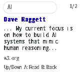
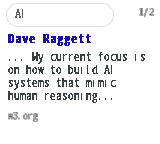

# Native search result presentation

The `0.14.10` native result screen makes the page title and its retained-text
excerpt the main content. It shows one selected result at a time on the
160 x 144 display:

- A compact query field and result number at the top.
- A blue, bold title, wrapping to at most two 20-cell lines.
- Three excerpt lines for a two-line title, or four for a one-line title.
- A small gray authority label instead of a multi-line complete URL.

From `0.14.14`, result screens omit the persistent button legend, leaving the
title, excerpt and authority as the visible content. Up/Down selects, A reads,
B returns and Start edits the query. The optional browser preview follows this
presentation too; legacy result packets also omit the legend.

Select still opens complete admitted URL and acquisition details. Shortening the
visible source does not change the document identity, source policy or open
action. Long titles and excerpts end with an explicit ellipsis. The excerpt is
retained page text near the first matching query word, preferring a nearby
sentence or paragraph boundary. ASCII matching uses the ranker's word boundaries
and case folding; non-ASCII matching preserves UTF-8 boundaries. Title-only
matches use the beginning of the retained body. No model-generated summary or
additional network request is involved.

## Packet and memory scope

PCS1 framing, per-line validation, pagination, IDs and the Rust/C ABI stay
unchanged. The autonomous adapter marks replies as local. Successful native
result packets use the existing title field for the first title line, line 0
for a possibly empty title continuation, line 1 for the authority, and lines 2
onward for the excerpt. The native result renderer applies this convention only
to local result replies with a nonzero document ID. Empty results and optional
companion packets keep their existing presentation and action validation.

Excerpt construction uses fixed stack buffers; it adds no persistent document
fields, storage migration, dynamic allocation or dependency. The index, ranking,
retained content, article layout and image pipeline are unchanged. The optional
browser canvas follows the same visual hierarchy from companion metadata; it
remains an approximate host preview, not physical LCD evidence.

Host checks cover query-context selection beyond navigation, ASCII whole-word
and case behavior, title-only matches, Japanese UTF-8, valid PCS1 decoding and
article access. Native candidate/readback, actual framebuffer observations and
operator observations must be recorded separately; older image endurance does
not qualify a new complete firmware release.

## Installed native verification

The installed `0.14.10` application is source
`c6d7adecd50a58d4bc8934eea4fe2f0d146cefd4`, SHA-256
`14ff36b0a2a21f2613d65bcd07ed11ee6c2f3dc9c54990fa3fac172cced95a3a`,
2,020,800 bytes. Application-only readback succeeds and the partition table,
NVS and four-document saved corpus remain unchanged. The console restores
generation 13 with zero storage failures. Local state remains 21,936 bytes
within its 22,272-byte reservation.

Native `AI` search returns two matching pages from the four retained documents.
The selected result, down/up selection and return-from-reader/details operations
take 6.305–7.066 ms of ranking/packet work, with 7–8 ms request observations,
zero network bytes and zero packet-decoder allocations. A opens document 3,
B restores result 2/2, Select opens complete source details and B restores
that result. The operator confirms the blue title and short explanation on
the actual LCD. See the [sanitized record](evidence/native-search-results/verification.json).

These are native MCU buffer readbacks of the installed application; they are
not photographs or physical USB-video capture. One- and two-line result titles
and the excerpt/source separation fit the full 160 x 144 frame:

Controls were queued through the native GUI diagnostic path under USB power.
This scoped presentation check does not qualify battery operation, independent
physical button actuation, image endurance on this newer candidate or a complete
release. The earlier `0.14.9` image measurements retain their own identity.

## Quiet result screens on 0.14.14

The installed application uses source `ac4b7d7779e41bdccf79599bbb8eedd8a55eae99`,
SHA-256 `5a8846ea7f9b251ece755416b0d19e7535395a3fdbb62a660edcd46804e54b32`,
and 2,073,888 bytes. App-only readback passes; the partition table, Wi-Fi settings
and four-document generation-13 corpus are preserved. Both hosted CI jobs pass.

Both one- and two-line titles have an empty footer: every pixel in rows 128–143
of the native 160 x 144 readback is white. Console-queued Up/Down selects results,
A opens the reader, and B restores results after cancelling a pending image.
These controls and MCU render-buffer observations use USB power; independent
buttons/panel/video, battery and full release qualification remain unverified.
See [candidate-bound evidence](evidence/native-search-results/quiet-results-verification.json).

