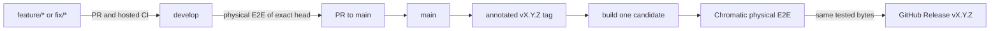

# Branches, versions, and release packages

## One version source

`Cargo.toml` → `[workspace.package].version` is the only package version declaration. Both Rust crates inherit it. `Cargo.lock`, compiled `--build-info`, native firmware metadata, the candidate manifest, Git tag, and release name must agree. `scripts/pipeline.py version` rejects drift.

Use stable semantic versions: **`vX.Y.Z`**, for example `v0.1.0`. Development candidates use `vX.Y.Z-dev.<12-character-commit>` filenames and cannot be promoted to a release. They are not stable Git tags. Protocol version `PCS1` is a separate compatibility version.

The companion's `--build-info` reports package version, exact source commit, and protocol version. Candidate builds require `POCKET_BUILD_COMMIT` to match the clean checked-out commit. A stale binary, dirty tracked source, wrong version, or wrong tag prevents packaging.

## Branch policy

- `develop` is the default branch and development integration branch.
- Feature and fix branches target `develop`; hosted CI checks PRs. Fork PR code never runs on the physical lab runner.
- Pushes to `develop` and `main` invoke physical qualification. Missing firmware, runner configuration, or physical evidence is a failure rather than a simulated pass.
- Promotion is a PR from `develop` to `main`, requiring hosted CI and the physical qualification result for that head. Put urgent fixes through the same path to keep branches aligned.
- A stable tag is annotated, matches the workspace version exactly, and points to a commit in `main` history. Tag updates and deletions should be prohibited.
- The tag pipeline builds and physically qualifies a fresh release candidate, then publishes exactly those tested files. It never promotes a development candidate or rebuilds after E2E.
- After a release, merge `main` back into `develop` through a PR if their histories diverged, before preparing the next workspace version. Version changes follow the same PR and check requirements as other changes.

`main` represents release-ready code. Until a real Pocket Search MCU application, lab adapter, reachable HTTPS fixture origin, and runner are configured, physical qualification stays blocked and there is no qualified firmware release.

## CI and CD

| Workflow | Trigger | Purpose |
| --- | --- | --- |
| CI | PRs and pushes for `develop` / `main` | Version/lock agreement, Python release-gate tests, Rust checks and host profile checks |
| Hardware E2E | Trusted pushes to `develop` / `main`, or manual branch dispatch | Build candidate, require real lab readiness, run physical native Wi-Fi scenarios |
| Chromatic qualification | Reusable workflow | Same build/physical-gate implementation for development and tags |
| Release | Push of `v*` tag | Validate strict version and main provenance, qualify candidate, publish exact tested assets |

Physical jobs share one concurrency group and do not cancel an in-progress flash/test when another commit arrives. They use the protected `chromatic-lab` environment and a dedicated self-hosted runner labeled `chromatic`. Third-party Actions are pinned to verified upstream commit SHAs. Hosted tests have read-only permissions; only the publish job receives release write access.

The hosted readiness check prevents allocating a lab job when the application or configuration is absent. `chromatic-required` explicitly fails when build, readiness, or the physical job is missing, failed, or skipped. It is not a host-test fallback. See the [lab setup](hardware-e2e.md).

## Package contents

A qualified release has:

- `pocket-search-vX.Y.Z-source.zip`: source from the exact committed revision, including GPL license and build documentation.
- `pocket-search-vX.Y.Z-<host-target>.tar.gz`: the compiled companion CLI, README, license, and notices.
- `chromatic-vX.Y.Z.bin`: the native ESP32 application image built from that same source/version.
- `candidate.json`: the immutable tested manifest with commit, version, protocol, asset sizes, and SHA-256 hashes.
- `release.json`: qualified status tied to the candidate digest and validated evidence digest.
- `e2e.json`, `junit.xml`, and selected physical USB-video PNGs: sanitized E2E evidence.
- `SHA256SUMS`: checksums for all published files.

The image is application-only. Partition migration, bootloader, FPGA, eFuse, cartridge data, NVS contents, device backups, and credentials are not release assets. A lab driver must preserve settings and a verified recovery backup when installing the intended image. Source distribution must include applicable upstream notices and complete build instructions before firmware is released.

The initial pipeline packages one hosted Linux companion target. Additional targets need builds with their own verified `--build-info` and matching manifest entries; do not rename a binary to claim another architecture. The current native application is unimplemented, so development candidates contain source and companion files and cannot qualify as firmware releases.

## Preparing a version

On `develop`, update the workspace version, refresh `Cargo.lock` with Cargo, update release notes, and run CI. Only merge into `main` after real physical E2E succeeds. Create and push an annotated `vX.Y.Z` tag from that main commit. The release workflow checks all identities again before publication. Existing releases/assets are not overwritten automatically.

Branch protection should require `ci` on `develop` and both `ci` and `qualify / chromatic-required` for `main`, with PRs required, force pushes/deletions disabled, and administrator enforcement. The exact check names are confirmed from workflow runs. If the GitHub plan cannot enforce private-repository branch rules, document that limitation; the version/evidence gates still execute inside the release workflow.
