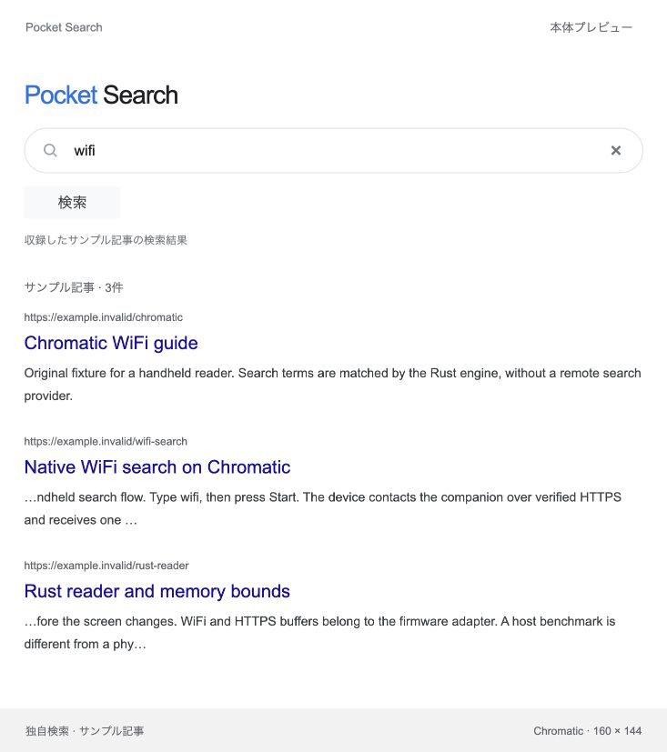
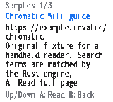
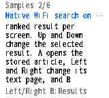
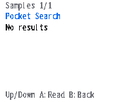

# Experimental search results and reader

The browser and native Chromatic UI now search the same immutable collection of **original sample articles**. Search results depend on the query and the Rust index's ranking; opening a result retrieves its stored text in PCS1 pages. The `.invalid` source URLs identify fixtures. This is not Google search, a crawler, or real-web browsing.

## Run the companion

```sh
cargo run --locked -- serve examples/documents.json 127.0.0.1:8828
```

The service embeds the allowlisted UI assets and serves GET requests only. Rebuild and restart after editing the UI. It never serves arbitrary files, proxies URLs, executes page scripts, or writes search history. This experimental command labels its collection as sample content; only load original or redistributable test articles. Do not expose private collections through a development tunnel.

| Route | Response |
| --- | --- |
| `/v1/search?q=wifi` | Up to ten JSON results, bounded titles, source URL excerpts and snippets; <=16 KiB |
| `/v1/chromatic/search?q=wifi&result=0` | One ranked PCS1 result; <=512 bytes |
| `/v1/chromatic/page?id=4&page=0` | One PCS1 text page; <=512 bytes |
| `/v1/collection` | Sample label and document count |

The decoded query is 1–96 UTF-8 bytes. Invalid UTF-8, controls, duplicate/unknown parameters, negative/invalid numbers, unknown documents and out-of-range pages are rejected. Empty results use document ID zero and have no open action. Browser titles are capped at 128 UTF-8 bytes, source URL excerpts and snippets at 256 each, with visible ellipses and a source URL truncation flag. Unused image URLs are omitted, control characters become spaces, and full URLs/bodies remain in the index for future source details and the reader. These field bounds also keep accepted long records within the JSON response cap.

The loaded collection stays immutable; IDs are valid for that process's collection. Live replacement still needs corpus generation checks.

Request headers are capped at 2 KiB, with a one-second socket read timeout and a three-second header window. Four workers and eight queued sockets cap application concurrency; a full queue returns 503. Writes have a one-second socket timeout. Responses include exact Content-Length, no-store, nosniff and a self-only content security policy. There is no query/body/request log. This is a development service, not a hardened production Internet server or a claim of per-client rate limiting.



The browser retry check used a separate local service: stop the service, open a result and observe the connection error, restart it, then open the result successfully with the stale notice cleared. Packet tests preserve U+FEFF/BOM content and enforce its width consistently with Rust.

## Native integration

`crates/chromatic-ffi` wraps the existing safe `no_std` decoder in a localized C ABI. Its 44-byte `PS_View` stores text offsets into the caller's retained packet. The wrapper and core allocate no heap memory. C callers must provide valid, aligned, non-overlapping memory and retain the packet while using the offsets. Networking, FreeRTOS tasks, LVGL labels and fonts have separate memory costs.

The actual ESP32 static library was built with an isolated esp-rs toolchain installed by espup 0.17.1: Rust `1.97.0-nightly`, compiler commit `8ea53bcd7257011cbf96f6398551bdc650b04334`, LLVM 21.1.3. The target command is:

```sh
# Use the already installed isolated esp toolchain, without changing the default.
RUSTUP_HOME=/path/to/isolated-rustup \
CARGO_TARGET_DIR=/path/to/native-target \
cargo +esp build -Zbuild-std=core --target xtensa-esp32-none-elf \
  -p chromatic-ffi --features native --profile chromatic-size
```

Set `POCKET_RUST_ARCHIVE` in the ESP-IDF root CMake project to the resulting `libchromatic_ffi.a`. The UI component imports it and links it through the existing Xtensa GCC 13.2.0 firmware build. Follow the [existing UI/menu integration](search-ui.md#native-integration); `PocketUI_Poll` must run on the GUI task. Existing Wi-Fi/SNTP adapters, certificate bundle, licensed `pocket_jp` font, upstream firmware changes and build configuration remain external. This describes the successful local integration, not a reproducible complete firmware distribution.

The adapter accepts one HTTPS origin through `search_endpoint https://hostname` in the authorized development console. It rejects credentials, paths, query strings, fragments and alternate ports, and keeps the origin in RAM only. It requires native Wi-Fi and native clock synchronization, checks certificates and hostnames, disables redirects, and accepts only a complete PCS1 content-type response fitting 512 bytes. One request and one pending reply are retained; completion must match the active sequence/kind/page/document before rendering. Cancelled completions cannot replace a later screen.

Search requests run outside the GUI task. Clock waiting is capped at 20 seconds, socket operations use ten-second timeouts, and the body-read loop checks a 45-second elapsed window. These stage limits are not a guaranteed 45-second total wall-clock deadline. Loading, disconnected, clock failure, invalid response and connection failure are visible. Cancelling retains responsive input while the old worker finishes; an immediate retry may ask the user to wait. Native B/Select cancellation means leaving the loading screen and invalidating its reply, not asynchronously destroying a TLS task. This intentional single-worker boundary avoids unsafe cross-task client cleanup or overlapping TLS memory. Cooperative transport cancellation/queued retry remains a follow-up. No automatic retry storm is started.

Up/Down selects a result, A opens it, Left/Right changes the reader page, B returns to results, Start enters a query, and Select goes home. Home Select retains Wi-Fi settings. Seven text rows fit between the title and footer. The local font subset and LVGL visible missing-glyph placeholder are not full Unicode coverage; Japanese reading quality remains an acceptance task.

## Physical verification — 2026-10-10

The application-only image **0.13.11-results**, 1,870,560 bytes, SHA-256 `9426b4a3f72523659ed25b5e2aa4f123a657c16bcaed5d8c95a74d203b7b0d5b`, was installed on the previously backed-up development unit. The installer verified the previous application, intended unit, original recovery backup, unchanged partition table/NVS and new application readback. Bootloader, FPGA and eFuses were unchanged.

The operator authorized a temporary HTTPS tunnel because device-to-Mac LAN reachability was not established. **The device fetched the search and reader packets over its own Wi-Fi**, with native SNTP and TLS verification enabled. USB supplied the origin, synthetic controls, diagnostics and MCU render-buffer readbacks; it did not supply page contents or the clock.

The [sanitized evidence](evidence/search-results/verification.json) records the initial collection at commit `5f337fc2eff378ff1f91652356b7265d23900028`; later sample prose removes repeated filler. It records:

- `wifi`: three results; first document 2, then document 4 selected with Down.
- A opens document 4's six-page reader; Right changes page 0 to 1, Left returns to 0, and B returns to the same result.
- `Rust` changes the first result to document 5; an unmatched query returns ID zero and A cannot open it.
- The exact Xtensa Rust decoder executes successfully through the C ABI; component source hashes match the local build tree and the linked Rust archive has a recorded hash.
- Nine successful requests used 44–208-byte packets. The first took 5,410 ms; the subsequent eight had a 2,174 ms median through this temporary Internet path. These include network/TLS work and are not decoder or rendering benchmarks.

The operator separately confirmed that this image's physical LCD showed the result and that real A, Left/Right and B worked. Automated controls were synthetic; there is no automated physical-buttons or USB-video qualification claim. The recorded free-heap snapshot is not TLS peak memory. Full-body/mixed-language physical acceptance, network-failure/reconnection checks, battery-only use and the dedicated release lab remain pending.

These are **physical MCU render-buffer readbacks over USB**, not browser simulations or USB video:

| Result | Reader page 2 | Empty results |
| --- | --- | --- |
|  |  |  |

The experimental image uses an upstream development identity separate from the workspace's `0.1.0` release identity. No firmware binary, toolchain, third-party font, device backup, NVS dump or raw device log is distributed. The temporary tunnel lasts only while its local processes run; the RAM origin is lost at reboot. `CHROMATIC_E2E_READY` remains false and no stable release qualification is claimed.
