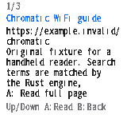

# Search service setup and restart recovery

> This document describes optional or historical companion tooling. The current native on-device mode does not require this service or a temporary tunnel; see [the main README](../README.md). Its fixed native source profile and image limitations are separate.

The Chromatic fetches results through its own Wi-Fi from the Rust companion. Running the browser preview on a Mac does not configure the handheld. The device needs a reachable HTTPS origin, a valid certificate, and its native synchronized clock.

An experimental device previously kept its origin only in RAM. Power cycling, firmware updates, and opening the development USB diagnostics could reset the MCU and clear that origin. The result was `Search service not configured.` even while the companion and temporary tunnel were working.

## Configure the handheld

Use the authorized development console on the intended Chromatic:

```text
search_endpoint https://your-reachable-host.example --save
search_endpoint status
```

`--save` explicitly persists the origin in the `pocket_search` NVS namespace. Successful configuration requires a commit and matching readback. Boot reads and validates this saved origin. An unchanged origin does not trigger another write. Status reports `configured`, `restore_on_restart`, `saving`, and `storage_error`, without disclosing the hostname, query, or Wi-Fi credentials.

The original `search_endpoint https://hostname` form remains a RAM-only override for temporary tests. It does not overwrite a saved origin; the previously saved origin returns on restart. A rejected input or failed save leaves the active RAM origin unchanged. Storage failures may still require an explicit retry and inspection; this is not a power-loss transactional storage guarantee.

Only bounded ASCII HTTPS hostnames are accepted. Credentials, paths, ports, query strings, fragments, malformed labels, and oversized values are rejected. Missing or corrupt saved data leaves the service unconfigured. Startup does not erase NVS or reset Wi-Fi settings to recover a storage error. NVS I/O occurs outside the network spinlock, and configuration reserves the single request slot while saving.

## Keep the companion reachable

Use the existing owned sample service with the original sample documents and registered images. Its local preview normally listens at `127.0.0.1:8828`. A development tunnel exposes only that read-only fixture service when the operator has authorized it. Private collections and credential files must stay outside it.

Saving a temporary tunnel address does not make it permanent. Both the companion and tunnel must remain running. If the tunnel address changes, configure and save the new origin. Do not disable certificate verification to recover connectivity. A permanent deployment and automatic host service startup remain separate work.

## Verification scope

The host C test exercises the actual origin storage implementation with a controlled NVS fixture: cold-start restoration, missing/corrupt/oversized records, hostname bounds, failed open/set/commit/read, and unchanged-save write suppression. This fixture is not physical flash evidence. The full MCU build and physical request/restart evidence must be recorded separately. USB diagnostic inputs are synthetic; native Wi-Fi requests and MCU render-buffer readbacks do not prove physical button automation, LCD scanout, or release qualification.

## Physical recovery check — 2026-10-10

The experimental application-only image **0.13.15-svc**, **1,874,896 bytes**, SHA-256 `c7a025f9a70a027716e6de9e13fba7b72b8920e7539a750d52336269e13b9c5f`, was built with ESP-IDF 5.3 and the existing linked Xtensa decoder. The installer verified the previous 0.13.13-dom application, intended backed-up unit, unchanged partition table/NVS, and new application readback. Bootloader, FPGA and eFuses were unchanged. The image is 1,104 bytes larger than the previous experimental image; this is a file-size comparison, not a RAM or CPU benchmark.

The origin was explicitly saved after installation. Reopening the development USB connection restarted the MCU. The fresh clock was initially unsynchronized (`unix_time: 6`, `sync_count: 0`); endpoint status already reported a valid saved origin. **No configure/save command was sent after this restart.** The handheld then synchronized its own clock, fetched the three-result `wifi` search, opened the first article with synthetic A, and returned with synthetic B. All three requests passed certificate/hostname validation and completed in 1,980–2,792 ms. USB carried controls and diagnostics; it did not supply pages or time.

The [sanitized evidence](evidence/search-service/verification.json) binds source hashes, the linked decoder, installed image and actual MCU requests. The operator separately confirmed that search results were visible on the physical LCD. The retained image below is a **physical MCU render-buffer readback**, not a USB video capture. A battery-only power cycle and automated physical-button E2E were not performed. This experiment does not qualify a stable release or make the temporary development origin permanent.


