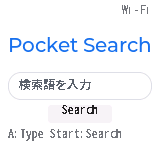
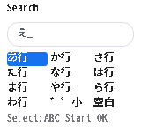
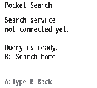
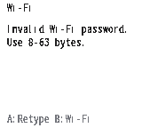
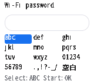

# Search-first UI

The initial home is a white screen with Pocket Search, one query field, and a search action. The previous Codex login/approval interface and Google-forwarding browser entry are obsolete. The browser preview and native component are repository-owned so UI changes do not live only in an older working directory.

## Implemented scope

- Browser search home, clear/focus behavior, UTF-8 query-length errors, and optional button/canvas preview.
- Native C/LVGL home, physical-button adapter, bounded keyboard, existing Wi-Fi configuration, and a visible service-unconnected state.
- Hiragana, Latin letters, digits, symbols, and kana modifiers; temporary query state only. No kanji conversion, input history, account session, or approval request.
- Portable, allocation-free input editing with a 96-byte query bound; SSID/password entry uses its own smaller limits and masks the password.

The Rust decoder, PCS1 network adapter, search API, results, and full reader are not connected to this UI. Start reports the missing search service. This is an input/display integration step, not completion of P0, native HTTPS search, or hardware release qualification. See [roadmap](roadmap.md).

## Native integration

`devices/chromatic/components/pocket_search_ui` targets the inspected ESP-IDF 5.3/LVGL 8.4.0 environment. It uses the existing `common`, `button`, `menu_mgr`, `tab`, `chromatic_wifi`, and `fonts` adapters. The externally supplied `pocket_jp` font remains required; unsupported glyphs need a visible fallback. No font or vendor firmware is bundled by this component.

For the existing development firmware:

1. Add the UI component and make OSD/main depend on `pocket_search_ui`. Remove the old `system/pocket_ui.c` from OSD's source list and the `chromatic_pocket` dependency from OSD/main; exclude that obsolete backend component.
2. Include `pocket_search_ui.h` in OSD/default/main and rename the old menu tab ID to `kTabID_Search` without changing its numeric position. Register `PocketUI_*` and `PocketEntry_*` callbacks and label the system entry `SEARCH`.
3. Remove `PP_Init()` and register `PocketUI_RegisterCommands()` instead. Call `PocketUI_Poll()` only on the GUI task before `lv_timer_handler()`; input diagnostics are queued into that task. Keep normal physical-button dispatch through the menu manager.
4. Enable `CONFIG_LV_FONT_MONTSERRAT_20` for the wordmark, or use the default-font fallback. Retain the measured 48-row display transport and graphics optimization. Convert the existing 1,000-microsecond tick period to 1 millisecond for `lv_tick_inc`; earlier benchmark images retain their original tick configuration and measurements.
5. Give the experimental image a unique identity. Verify the exact previous application, intended unit, partition table, original recovery backup, and unchanged NVS before/after an application-only update. Do not package that experimental image as a qualified release.

The complete upstream integration and local font/build environment are still external to this repository. This component alone is not a reproducible complete Pocket Search firmware deliverable. Native application identity must eventually follow the workspace version and qualification policy.

## Verification boundary

Hosted checks cover UTF-8 boundaries, invalid sequences, atomic overflow rejection, whole-code-point deletion, kana modifiers, and browser button state. The current browser was checked for empty/oversized/valid submission, explicit unconnected status, kana selection/deletion, and a return to the empty home.

The target component was compiled in the existing Xtensa firmware. `search_ui` provides **synthetic GUI input** (`home`, directional keys, `a`, `b`, `start`, `select`, `status`) for bounded checks; status exposes mode/query-byte count without query contents or credentials. These diagnostics do not prove physical button presses, native network traffic, panel scanout, USB-video capture, or full E2E.

## Experimental device verification — 2026-10-10

The application-only image `0.13.10-search-ui` (1,851,984 bytes; SHA-256 `84cdd86064b09c75a9612ed53ba432d4e9d12cabcf9bc8a642ffc3fe50c6d8f0`) was installed on the previously backed-up development unit. Installation verified the previous application, new application readback, unchanged partition table, unchanged NVS, and original recovery backup. Bootloader, FPGA, and eFuses were not modified. The obsolete account/approval backend was excluded from this build.

The [sanitized report](evidence/search-ui/verification.json) records byte-identical component sources and six MCU render-buffer captures. Synthetic GUI inputs moved down from `あ` to select `え`, submitted a three-byte query to the explicit unconnected state, and returned to an empty home. They also checked the rejected-password notice and A's return to the password keyboard, using an invented one-byte password that the existing join function rejects before enqueueing any network/settings write. The report's free-heap value is a diagnostic snapshot with capture allocations released, not a performance comparison or peak-memory result. Wi-Fi status does not establish a search-service request.

The operator separately confirmed that the initial `0.13.9-search-ui` image showed the white home on the physical LCD and that the real A button opened input. That observation is recorded with its own version/source, separate from the revised image's automated synthetic-input checks. Other physical controls and panel output were not independently captured. The images below are **MCU render-buffer readbacks over USB**, not USB video or browser simulations.

| Search home | Hiragana input | Unconnected service |
| --- | --- | --- |
|  |  |  |

| Rejected password | A returns to password entry |
| --- | --- |
|  |  |

The full local firmware/font integration is external, and this experimental identity does not match the Rust workspace release identity. No firmware binary, device backup, NVS dump, credentials, or raw device log is committed or distributed. This check does not satisfy the physical release gate.
